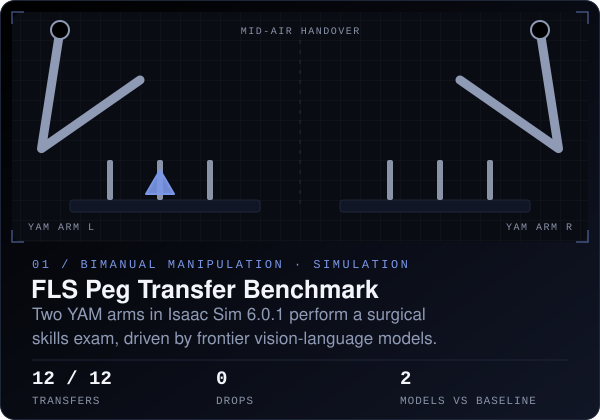

<h1 align="center">Adyaa Khera</h1>

<b>Robotics, Purdue University</b>

  
  
  

I'm a junior in Robotics at Purdue University and an undergraduate researcher at Purdue's MARS Lab. I work on robot manipulation, tactile sensing, robot learning and embedded systems.

## Research

**MARS Lab, Purdue University**: Undergraduate researcher working on tactile sensing and contact-aware robotic manipulation.

**Publications**

- *MVP-Tac: A Miniaturized Dual-Modal Vision and Photoelastic Tactile Sensor for Robot-Assisted Minimally Invasive Surgery*. IROS 2026 (accepted). [Paper](https://arxiv.org/abs/2607.18660) · [Project page](https://mvp-tac.github.io)
- *LuxTac: A Flexible, Scalable, and Open-Source Optical Taxel Array with Distributed Three-Axis Force Sensing for Tactile Robot Learning*. arXiv 2026. [Paper](https://arxiv.org/abs/2611.23575) · [Project page](https://luxtac.github.io)

## Projects

<table>
  <tr>
    <td width="50%"></td>
    <td width="50%"></td>
  </tr>
  <tr>
    <td width="50%"></td>
    <td width="50%"></td>
  </tr>
</table>

## Skills

- **Robot learning:** PyTorch, LeRobot, diffusion policies, computer vision
- **Simulation:** Isaac Sim, Isaac Lab, MuJoCo
- **Control:** kinematics, motion planning, feedback control, state estimation
- **Embedded:** C/C++, Python, Arduino, Raspberry Pi, sensor integration
- **Industrial:** FANUC, Yamaha SCARA
- **Engineering:** CAD, 3D printing, hardware debugging
